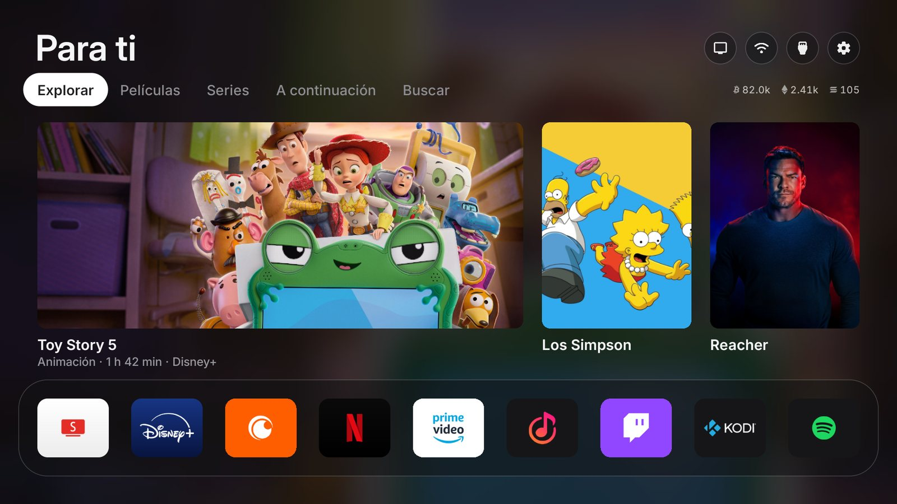
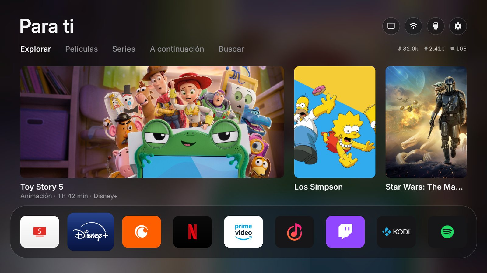
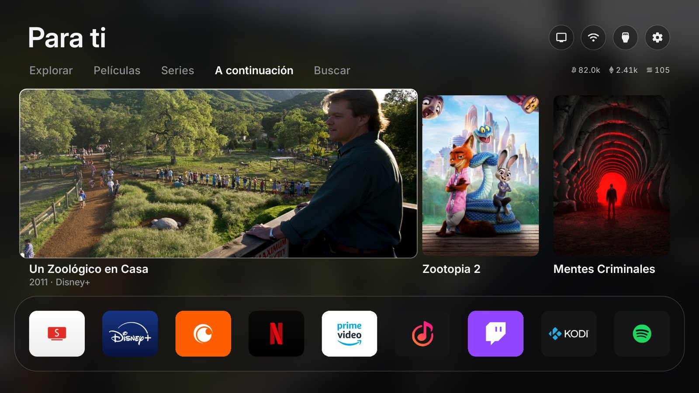
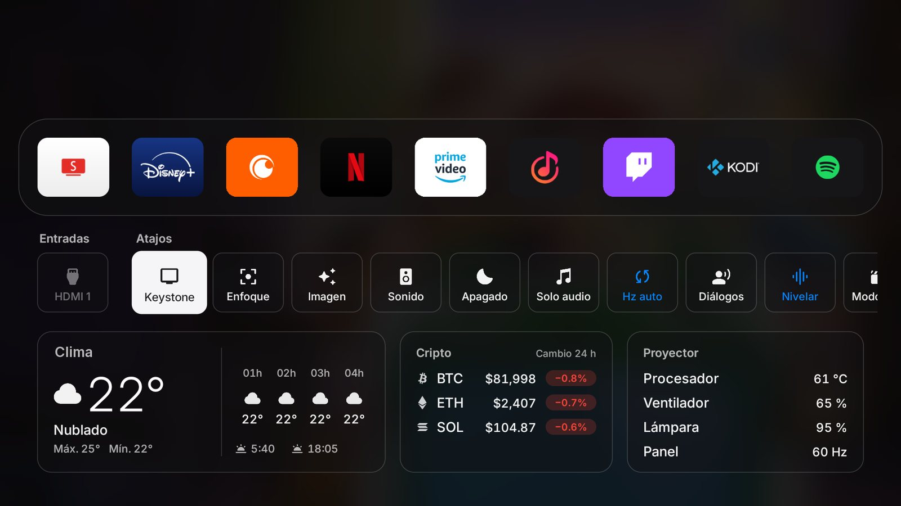
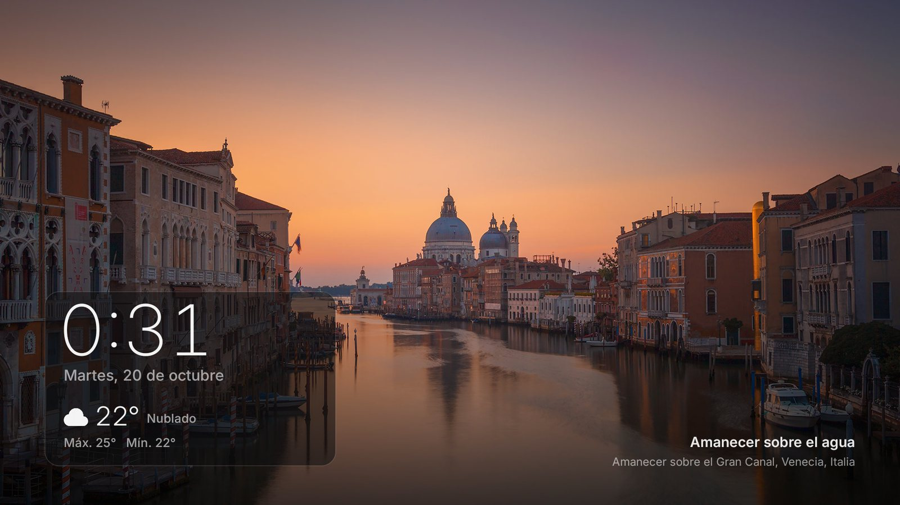
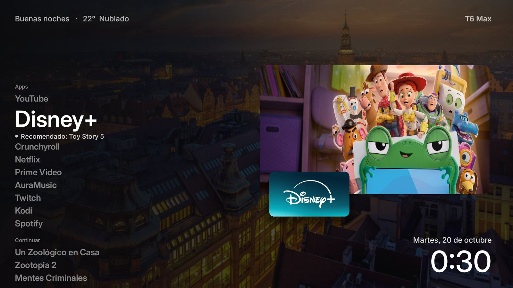
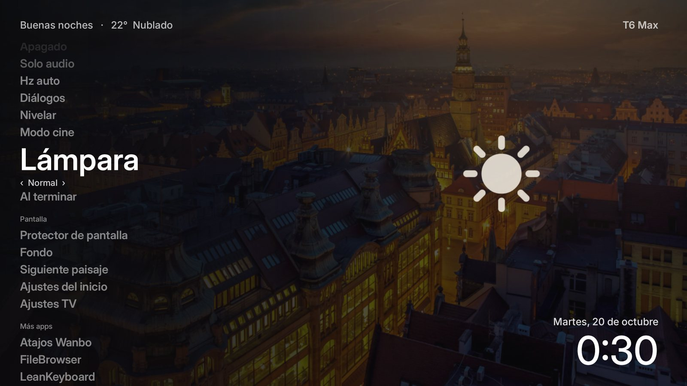

<div align="center">


# Free My Projector

[English](README.md) · **Español**

**Una pantalla de inicio rápida y sin anuncios para proyectores con Android 9 o superior.**

Fork de [Free My TV](https://github.com/simbasjungles/free-my-tv) adaptado a proyectores, probado en un Wanbo T6 Max (Amlogic T972, Android 9).<br>
El README del proyecto original está en [README-original.md](README-original.md).

</div>

<p align="center"></p>

## Qué tiene

- **Dos diseños** (Ajustes del inicio → Diseño del inicio):
  - **Clásico**: el de tvOS, con vidrio, tarjetas y estante.
  - **Ligero**: una lista de nombres por secciones (Apps, Continuar, Entradas, Proyector, Pantalla, Más apps). El elegido se agranda con su estado debajo ("Recomendado: …", "Sin señal", "Activado"); a la derecha, la foto recomendada con la ficha de la app; saludo y clima arriba, fecha y hora grandes abajo. Sin vidrio ni desenfoques en vivo: el más fluido en un proyector. ↑ ↓ recorren, ← → saltan de sección, ≡ va directo al Proyector. **Fondo ‹ Animado · Nítido · Desenfocado · Negro ›** se cambia con ← → (Animado, el predeterminado, recorre los paisajes con un zoom lento y pasa al siguiente con un fundido cada 30 s), y **Siguiente paisaje** pasa a otra foto.
- **Tus apps en un estante.** SmartTube, Disney+, Crunchyroll, Netflix, Prime Video, AuraMusic, Twitch, Kodi, Spotify… las que tengas instaladas.
  - **Edítalo como en tvOS:** mantén OK sobre una app y empieza a temblar; ← → la mueve, ↓ la oculta (pasa a Todas las apps) y OK termina. Para devolver una app oculta, mantén OK sobre ella en Todas las apps.
- **Recomendaciones de tus apps.** Lo que está en tendencia esta semana y los estrenos, solo de los servicios que tienes, en tu país y en español (TMDB). Al elegir una, se abre **directo en la película o serie** dentro de su app (Disney+, Netflix, Prime Video, Crunchyroll), con los IDs que guarda Wikidata; si no lo tiene, se abre la app.
- **Una ficha para cada título**, como en la app del Apple TV: al elegir una tarjeta (o un resultado de Buscar, o A continuación) se abre su página —la foto a pantalla completa con un zoom lento, año · géneros · duración · nota, sinopsis y reparto— con **Ver en Disney+** (directo al título) y **Tráiler** (en SmartTube). El botón grande de arriba sigue abriendo directo.
- **¿Qué veo hoy?** Un botón (arriba a la derecha, o la primera fila en el diseño Ligero) abre la ficha de un título elegido al azar entre tus apps; **Otra** vuelve a sortear.
- **Top Shelf**, como en tvOS: al pasar por Disney+, Netflix, Prime Video o Crunchyroll en el estante, las tarjetas de arriba muestran lo recomendado de esa app; sube y ábrelo directo.
- **A continuación**, como en tvOS: una pestaña con lo último que abriste desde el inicio, para retomarlo. Aparece cuando abres el primer título. Las series muestran **Episodio nuevo** cuando sale uno después de que la viste (o "Nuevo el viernes" si falta menos de una semana).
- **Centro de control** como el de tvOS: se abre con el botón ≡ del control (o bajando al cajón).
  - Atajos a **Keystone**, **Imagen** (modo, color, nitidez, reducción de ruido), **Sonido** (ecualizador, DTS, VirtualX) y **Apagado** (temporizador; muestra los minutos que quedan).
  - **Ajustar pantalla**, en tres pasos: **enfoque** (el autoenfoque arranca solo con la cámara del proyector; ← → mueven la lente a mano sobre texto fino en el centro y las esquinas), **forma** (un marco en los bordes para ver si la imagen sale rectangular; *Ajustar esquinas* abre el keystone manual, más preciso que el automático) y **brillo** (Normal, Eco o Noche, con una sugerencia según la hora).
  - **Solo audio**: apaga la lámpara y la música sigue sonando (Spotify, AuraMusic, podcasts). Menos calor y ruido, y el LED dura más. Cualquier botón, el volumen incluido, trae la imagen de vuelta.
  - Interruptores que se aplican al instante y se iluminan en azul: **Hz auto** (la pantalla sigue los cuadros por segundo del video), **Diálogos** (realza las voces) y **Nivelar** (evita los saltos de volumen).
  - **Lámpara**: Normal → **Eco** (≈75 %) → **Noche** (≈50 %). Solo baja el brillo: si el proyector está caliente y Wanbo ya lo bajó más, manda Wanbo. Normal le devuelve la lámpara. No hay "Máximo" porque forzaría el LED.
  - **Al terminar** *(en pruebas)*: apaga el proyector cuando termina lo que estás viendo o escuchando (tres minutos sin nada reproduciéndose) y se desactiva solo. Si la app pasa sola al siguiente capítulo, sigue esperando.
  - **Modo cine**, un solo botón para ver una película: activa Hz auto y Diálogos y apaga Nivelar (aplana la banda sonora). Al apagarlo vuelve todo como estaba.
  - Una tarjeta con el **estado del equipo**: temperatura del procesador, ventilador, lámpara con sus **horas de uso** (contadas desde que instalas la app) y frecuencia del panel (se ve cambiar a 48 o 50 Hz si tienes AFR).
  - **Aviso de calor**: si el procesador pasa de 82 °C, aparece un aviso sobre cualquier app para que revises las rejillas (como mucho uno cada media hora).
- **Clima** por hora, amanecer y atardecer, y **precios cripto**.
- **Widgets** (diseño Ligero, arriba a la derecha, como en macOS): el próximo partido y el último resultado de **tu equipo de fútbol** (`football_team` en la configuración, TheSportsDB), el **próximo episodio** de una serie de A continuación y **lo que suena**, o el clima del resto del día. En el diseño Clásico, el día del partido este reemplaza a las cotizaciones.
- **Protector de paisajes**, como los fondos aéreos del Apple TV y la Mac: una foto de paisaje a pantalla completa cada minuto (las fotos del día de Bing, con el nombre del lugar) y un recuadro de vidrio con la hora, la fecha, el clima y lo que suena. También en **marco**, como el modo Arte de The Frame, o con las portadas de las recomendaciones. Se elige en los ajustes del inicio, y se activa al instante con **Atrás** en el inicio, como en el Apple TV.
- **Sonidos suaves al navegar**, como en tvOS: un tic al moverte, dos notas al abrir y al volver.
- **Modo oscuro fijo, claro fijo o automático** (claro de día, oscuro desde la puesta de sol), y un **protector de pantalla** con las portadas y un reloj grande.
- **Botón de Keystone** arriba a la derecha en vez de *TV en vivo* (los proyectores no tienen antena).
- **Buscar**, como en tvOS: una pestaña con teclado de una sola fila; muestra solo películas y series que están en tus apps y las abre directo. De fondo, el paisaje del día del protector.
- **Ahora suena**, como en tvOS: mientras Spotify, AuraMusic u otra app reproduce algo, la canción y el artista aparecen arriba a la derecha en lugar de las cotizaciones.
- **Resplandor de color y botón de red** (ideas de [Clean Your TV](https://github.com/Gathin23/cleanyourtv)): al pasar por una app del estante sube un brillo suave de su color, y un botón arriba muestra el WiFi y la señal.
- **Movimiento reducido** en los ajustes del inicio, para proyectores con GPU justa: el foco y el fondo cambian sin animación.
- **Poca memoria:** mientras usas otra app, el inicio suelta las fotos que no se ven.
- **Actualizaciones solas** de SmartTube, SmartTwitchTV y AuraMusic: una vez al día, mientras estás en el inicio, baja la última versión estable de su GitHub oficial y la instala solo si es más nueva y viene firmada por el mismo autor que la que tienes. Te avisa con un mensaje corto.
- **Un botón para volver.** *Original* devuelve tu inicio anterior (por ejemplo Projectivy), tu protector de pantalla y las apps tal como estaban.

## Capturas

<table>
<tr>
<td width="50%"><br><sub>Top Shelf: al pasar por Disney+ salen sus recomendaciones</sub></td>
<td width="50%"><br><sub>A continuación: retoma lo que estabas viendo</sub></td>
</tr>
<tr>
<td width="50%"><br><sub>Centro de control: controles del proyector y estado del equipo</sub></td>
<td width="50%"><br><sub>Protector de paisajes con hora, clima y el lugar</sub></td>
</tr>
<tr>
<td width="50%"><br><sub>Diseño Ligero: una lista con la foto recomendada</sub></td>
<td width="50%"><br><sub>Diseño Ligero: controles del proyector con valores (‹ Normal ›)</sub></td>
</tr>
</table>

## Qué cambia respecto al original

| | Free My TV | Free My Projector |
|---|---|---|
| Android | 12 o superior | **9 o superior** |
| Idiomas | inglés, portugués | **+ español** |
| Efectos de vidrio | shaders de Android 13 | vidrio plano en Android 9–12 (como el original en Android 12) |
| Rendimiento | chips de TV modernos | **modo liviano** en Android < 12: sin sombras difuminadas (en el T972 bajó de 46 a 7 ms por cuadro) |
| ADB interno | `127.0.0.1:5555` | también `:3333`, el que traen abierto los Wanbo |
| Detectar el inicio anterior | rol HOME (Android 10+) | también en Android 9, que no tiene roles |
| Al volver a *Original* | reactiva el inicio, el asistente de configuración y el protector | **deja apagado lo que ya estaba apagado** y restaura el protector que tenías elegido |
| Apps del estante | versiones de Google TV | también las versiones de celular que usan los proyectores |
| Compilar en Windows | — | `build.sh` funciona en Git Bash |

## Instalar

Necesitas una PC en la misma red WiFi que el proyector y la **depuración por red** activa en el proyector (los Wanbo la traen abierta en el puerto 3333).

### Con Claude Code

1. Clona el repositorio:
   ```bash
   git clone <url-de-este-repositorio> free-my-projector && cd free-my-projector
   ```
2. Abre [Claude Code](https://claude.com/claude-code) en esa carpeta y dile, por ejemplo:
   > Instala Free My Projector en mi proyector 192.168.1.50. Vivo en Madrid.

### A mano

1. **Herramientas:** un JDK 17+, el Android SDK (build-tools 34+, platform android-34) y adb. En Windows usa Git Bash; si el JDK es el de Android Studio:
   ```bash
   export JAVA_HOME='/c/Program Files/Android/Android Studio/jbr'
   ```
2. **Compila:**
   ```bash
   bash build.sh
   ```
   La primera vez crea `config.properties`: pon ahí tu ciudad, tu país y tu clave de TMDB, y compila de nuevo.
3. **Instala:**
   ```bash
   adb connect 192.168.1.50:3333
   adb install -r FreeMyTV.apk
   ```
4. **En el proyector:** abre *Free My Projector* → *Inicio* → *Free My Projector*. Espera un minuto (mide y cambia) y presiona Home.

## Configuración

Todo está en `config.properties` (no se sube a git):

| Clave | Para qué | Ejemplo |
|---|---|---|
| `tmdb_key` | Tu clave gratis de TMDB, para las recomendaciones | — |
| `tmdb_region` | Tu país (dos letras): qué título está en qué app | `ES` |
| `latitude`, `longitude` | Tu ciudad, para el clima y el atardecer | `40.4168`, `-3.7038` |
| `city` | El nombre en la tarjeta del clima | `Madrid` |
| `language` | `auto` (sigue al proyector), `es`, `en` o `pt` | `es` |
| `currency` | Moneda de los precios cripto | `USD` |
| `temperature` | `C`, `F` o `auto` | `C` |
| `theme` | `auto` (claro de día, oscuro de noche), `dark` o `light` | `dark` |
| `football_team` | Tu equipo, para el widget de fútbol (vacío = ninguno) | `Real Madrid` |

**La clave de TMDB:** crea una cuenta gratis en [themoviedb.org](https://www.themoviedb.org/signup), entra a [Settings → API](https://www.themoviedb.org/settings/api) y pide una clave de desarrollador. Pega la *API Key* después de `tmdb_key=`.

## Volver atrás

En el proyector: *Free My Projector* → *Inicio* → *Original*. Vuelve tu inicio anterior, tu protector de pantalla y las apps como estaban. Si el nuevo inicio se cierra tres veces en cinco minutos, vuelve solo.

Para quitarlo del todo: primero *Original* y después desinstala la app.

## Para proyectores Wanbo con ROM modificada

Los atajos de **Imagen** y **Efectos de sonido** abren pantallas ocultas de Amlogic que no están exportadas. Se abren a través de *Puente Wanbo*, una app pequeña firmada con la clave de plataforma que viene en esa ROM. En otros proyectores esos dos atajos simplemente no aparecen; el resto funciona igual.

## Créditos

[Free My TV](https://github.com/simbasjungles/free-my-tv) de simbasjungles (licencia MIT). Este fork mantiene la misma licencia y trae los cambios del original cuando se puede.

Este producto usa la API de TMDB, pero TMDB no lo respalda ni lo certifica.
